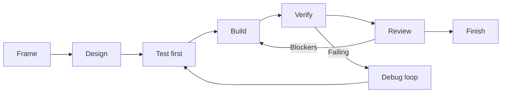

# shipshape

**One command that turns Claude Code into a disciplined engineering team.**

`/ship` combines the best rules from four Claude Code skill packs (ponytail, pstack, superpowers, and a lifecycle pack) into one tiered workflow. Every coding task gets framed, designed, tested first, built, proven on the real app, and reviewed for security, over-engineering, and readability. Small tasks stay fast. Risky tasks get the full treatment.

## Why

Installing several skill packs side by side creates problems:

- Four code reviewers, three debugging loops, two planning systems.
- Contradicting orders: "do less" vs "build 3 prototypes", "tests first" vs "tests after", "stop for approval" vs "never block".
- Heavy ceremony on every one-line fix.

shipshape picks one owner per phase, sets precedence between packs, and scales the process to the risk of the task.

| Without shipshape | With shipshape |
|---|---|
| You pick skills by hand each task | `/ship` picks them, or runs by default |
| Packs give conflicting rules | One precedence order |
| Same ceremony for a typo and a payment change | S, M, L tiers |
| "Done" based on "it compiles" | "Done" means fresh command output from the real app |
| Code reviewed by the model that wrote it | Reviewed on a different model |

