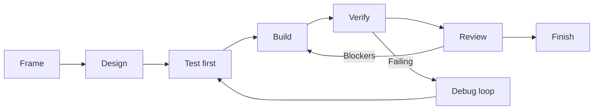

# shipshape

**One command that turns Claude Code into a disciplined engineering team.**

`/ship` combines the best rules from four Claude Code skill packs (ponytail, pstack, superpowers, and a lifecycle pack) into one tiered workflow. Every coding task gets framed, designed, tested first, built, proven on the real app, and reviewed for security, over-engineering, and readability. Small tasks stay fast. Risky tasks get the full treatment.

