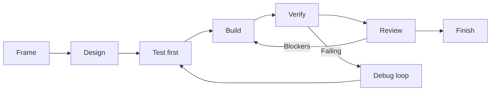
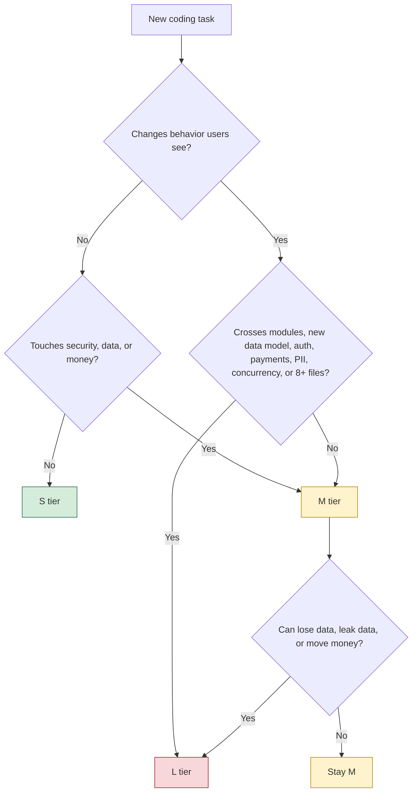
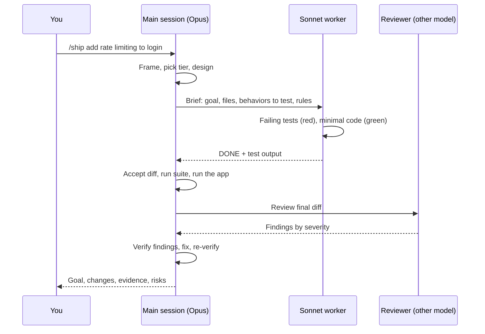
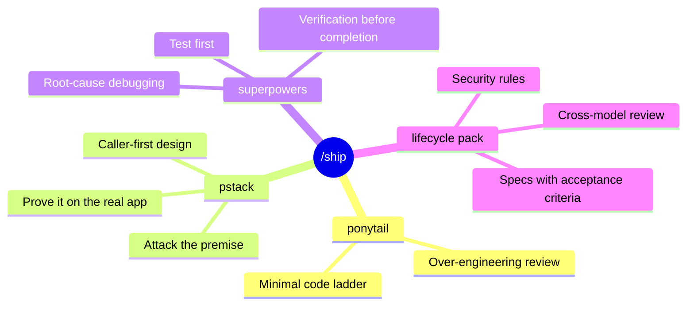

# shipshape

**One command that turns Claude Code into a disciplined engineering team.**

`/ship` combines the best rules from four Claude Code skill packs (ponytail, pstack, superpowers, and a lifecycle pack) into one tiered workflow. Every coding task gets framed, designed, tested first, built, proven on the real app, and reviewed for security, over-engineering, and readability. Small tasks stay fast. Risky tasks get the full treatment.

## Why

Installing several skill packs side by side creates problems:

- Four code reviewers, three debugging loops, two planning systems.
- Contradicting orders: "do less" vs "build 3 prototypes", "tests first" vs "tests after", "stop for approval" vs "never block".
- Heavy ceremony on every one-line fix.

shipshape picks one owner per phase, sets precedence between packs, and scales the process to the risk of the task.

| Without shipshape | With shipshape |
|---|---|
| You pick skills by hand each task | `/ship` picks them, or runs by default |
| Packs give conflicting rules | One precedence order |
| Same ceremony for a typo and a payment change | S, M, L tiers |
| "Done" based on "it compiles" | "Done" means fresh command output from the real app |
| Code reviewed by the model that wrote it | Reviewed on a different model |

## Features

- **Risk-based tiers.** S for trivial edits, M for normal features and every bug fix, L for anything touching auth, payments, personal data, migrations, or public APIs.
- **Test first.** Failing test before code. Each test names the bug it catches. Never weaken an assertion to go green.
- **Security in every phase.** Not a step you can forget: tier choice, spec, tests, build rules, and review all carry it.
- **Minimal code.** ponytail's ladder: reuse, stdlib, native, existing dependency, then new code.
- **Proof on the real artifact.** Run the app, CLI, or endpoint the way a user would.
- **Cross-model review.** Separate passes for correctness and security, over-engineering, and readability.
- **Orchestrator and workers.** Opus plans and reviews. Sonnet workers build. No two workers touch the same files.
- **On by default.** One rule in your global `CLAUDE.md` applies it to every project.

## How it works

### Tier selection

### What each tier runs

| Phase | S | M | L |
|---|:---:|:---:|:---:|
| Frame: restate goal, read callers | ✅ | ✅ | ✅ |
| Design: data shape, caller-first | | ✅ | ✅ |
| Spec via `/architect` | | | ✅ |
| Failing test first | if logic changes | ✅ | ✅ + tagged to spec |
| Built by Sonnet workers | one-liners inline | ✅ | ✅ in parallel |
| Full suite + run the real app | ✅ | ✅ | ✅ + `/check verify` |
| Security, over-engineering, readability reviewers | self-review | ✅ | ✅ |
| Built-in `/security-review` + blast radius | | | ✅ |
| Report | code + 3 lines | full report | full report + `/document` |

### Who does what

### Where the rules come from

## Requirements

- [Claude Code](https://claude.com/claude-code)
- Access to the Opus and Sonnet models (Fable optional, for review panels)
- The skill packs below. shipshape routes to them; it does not bundle them.

| Pack | Source | Required for |
|---|---|---|
| ponytail | its own repository | Minimal-code rules (always on) |
| pstack | [backnotprop/pstack](https://github.com/backnotprop/pstack) | Principles, `pstack-architect`, `/poteto-mode` |
| superpowers | [obra/superpowers](https://github.com/obra/superpowers) | Debugging techniques, verification, review templates |
| lifecycle pack | its own repository | `/architect`, `/test`, `/check`, `/audit`, `/document`, `/sync` |

`/ship` still runs if a pack is missing. It skips the steps that need it.

