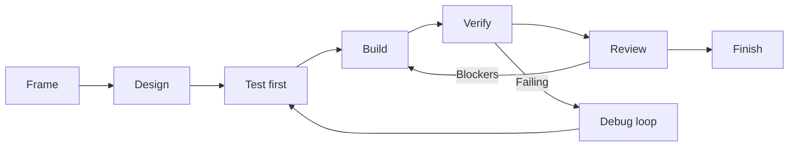
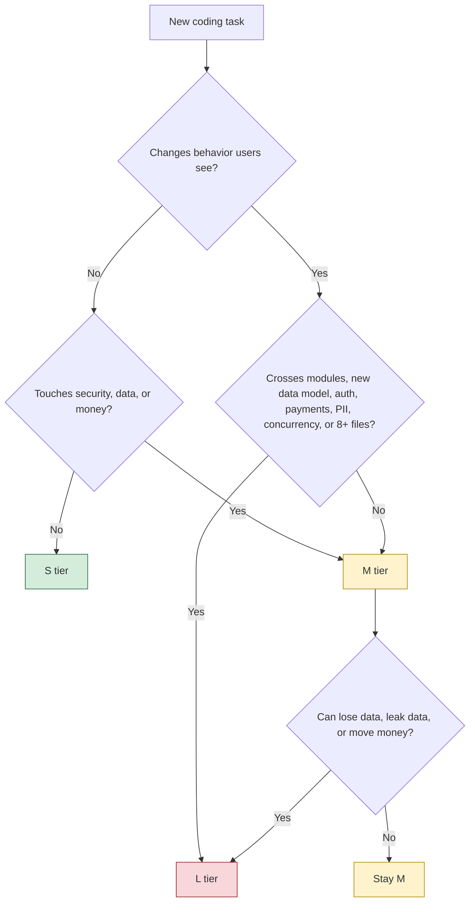
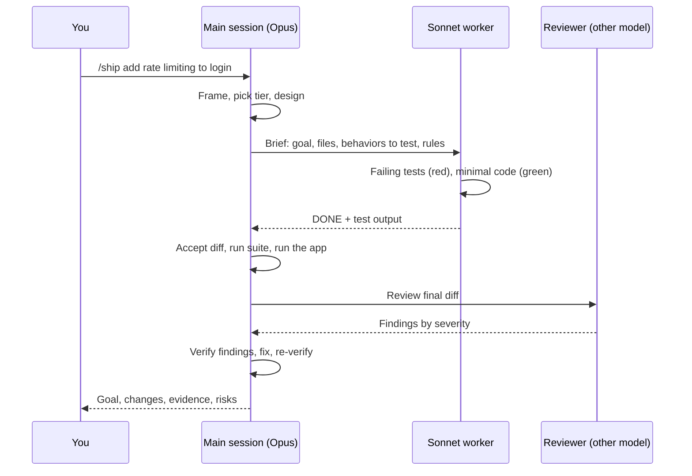
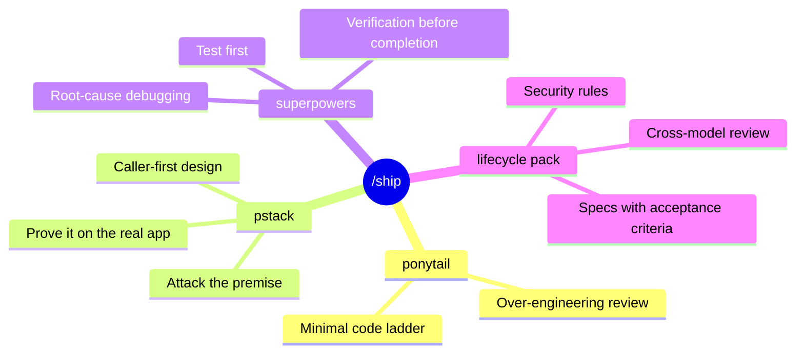

# shipshape

**One command that turns Claude Code into a disciplined engineering team.**

`/ship` combines the best rules from four Claude Code skill packs (ponytail, pstack, superpowers, and a lifecycle pack) into one tiered workflow. Every coding task gets framed, designed, tested first, built, proven on the real app, and reviewed for security, over-engineering, and readability. Small tasks stay fast. Risky tasks get the full treatment.



## Why

Installing several skill packs side by side creates problems:

- Four code reviewers, three debugging loops, two planning systems.
- Contradicting orders: "do less" vs "build 3 prototypes", "tests first" vs "tests after", "stop for approval" vs "never block".
- Heavy ceremony on every one-line fix.

shipshape picks one owner per phase, sets precedence between packs, and scales the process to the risk of the task.

| Without shipshape | With shipshape |
|---|---|
| You pick skills by hand each task | `/ship` picks them, or runs by default |
| Packs give conflicting rules | One precedence order |
| Same ceremony for a typo and a payment change | S, M, L tiers |
| "Done" based on "it compiles" | "Done" means fresh command output from the real app |
| Code reviewed by the model that wrote it | Reviewed on a different model |

## Features

- **Risk-based tiers.** S for trivial edits, M for normal features and every bug fix, L for anything touching auth, payments, personal data, migrations, or public APIs.
- **Test first.** Failing test before code. Each test names the bug it catches. Never weaken an assertion to go green.
- **Security in every phase.** Not a step you can forget: tier choice, spec, tests, build rules, and review all carry it.
- **Minimal code.** ponytail's ladder: reuse, stdlib, native, existing dependency, then new code.
- **Proof on the real artifact.** Run the app, CLI, or endpoint the way a user would.
- **Cross-model review.** Separate passes for correctness and security, over-engineering, and readability.
- **Orchestrator and workers.** Opus plans and reviews. Sonnet workers build. No two workers touch the same files.
- **On by default.** One rule in your global `CLAUDE.md` applies it to every project.

## How it works

### Tier selection



### What each tier runs

| Phase | S | M | L |
|---|:---:|:---:|:---:|
| Frame: restate goal, read callers | ✅ | ✅ | ✅ |
| Design: data shape, caller-first | | ✅ | ✅ |
| Spec via `/architect` | | | ✅ |
| Failing test first | if logic changes | ✅ | ✅ + tagged to spec |
| Built by Sonnet workers | one-liners inline | ✅ | ✅ in parallel |
| Full suite + run the real app | ✅ | ✅ | ✅ + `/check verify` |
| Security, over-engineering, readability reviewers | self-review | ✅ | ✅ |
| Built-in `/security-review` + blast radius | | | ✅ |
| Report | code + 3 lines | full report | full report + `/document` |

### Who does what



### Where the rules come from



## Requirements

- [Claude Code](https://claude.com/claude-code)
- Access to the Opus and Sonnet models (Fable optional, for review panels)
- The skill packs below. shipshape routes to them; it does not bundle them.

| Pack | Source | Required for |
|---|---|---|
| ponytail | its own repository | Minimal-code rules (always on) |
| pstack | [backnotprop/pstack](https://github.com/backnotprop/pstack) | Principles, `pstack-architect`, `/poteto-mode` |
| superpowers | [obra/superpowers](https://github.com/obra/superpowers) | Debugging techniques, verification, review templates |
| lifecycle pack | its own repository | `/architect`, `/test`, `/check`, `/audit`, `/document`, `/sync` |

`/ship` still runs if a pack is missing. It skips the steps that need it.

## Installation

**1. Read before you install.** Skills are instructions an agent follows, and some ship scripts. Check every pack for network calls, process spawning, secret access, and prompt injection before copying it in.

**2. Install the packs** listed above into `~/.claude/skills/`.

**3. Install shipshape.**

```bash
git clone https://github.com/gaderOussama/shipshape
```

```bash
cp -r shipshape/skills/ship ~/.claude/skills/ship
```

```bash
mkdir -p ~/.claude/rules && cp shipshape/rules/pstack-models.md ~/.claude/rules/
```

**4. Resolve the name clash (if you use both pstack and the lifecycle pack).** Both ship a skill called `architect`. Install pstack's copy as `pstack-architect` and change the `name:` line in its `SKILL.md`.

**5. Make it the default.** Append `CLAUDE.snippet.md` to your global `~/.claude/CLAUDE.md`:

```bash
cat shipshape/CLAUDE.snippet.md >> ~/.claude/CLAUDE.md
```

The snippet turns `/ship` on for every coding task and sets the precedence between packs. Start a new Claude Code session to load it.

## Usage

| Command | What it does |
|---|---|
| `/ship <task>` | Runs the full loop. Picks the tier itself. |
| `/ship S\|M\|L <task>` | Forces a tier. |
| `/ship review` | Reviews the current diff only. |
| `/ship setup` | One-time repo prep: detects test, lint, and run commands, writes `AGENTS.md`, proposes a test framework and pre-commit checks. Asks before installing anything. |
| `/poteto-mode` | Heavy mode for multi-hour, unattended, or multi-PR work. |
| "stop ship" | Turns it off for the session. |

With the `CLAUDE.md` snippet installed, you rarely type `/ship`. Ask for a change and the workflow runs.

```text
> /ship setup
  Detects the stack, records commands in AGENTS.md, offers a test framework.

> fix the bug where the cart total ignores discounts
  Tier M. Repro test fails, root cause found, fix, suite green,
  reviewed on a second model, short report with evidence.

> add Stripe webhooks for refunds
  Tier L (money). Spec with acceptance criteria, security model,
  tests per criterion, parallel workers, /security-review.
```

## Precedence

When packs disagree, this order wins:

1. **Your orchestration rule.** Sonnet workers build, Opus reviews. Pack model defaults are ignored.
2. **ponytail's minimal-code ladder.** When it and pstack disagree, the smaller change wins.
3. **`/ship` decides which skills run.** Skills that stop for approval (brainstorming, plan writing) run only when you name them.
4. **Outward actions always need a yes.** Commits, pushes, PRs, deploys, and messages.
5. **Cursor-only steps** in pstack (bugbot, automations, cloud agents) are skipped.

## Repository layout

```text
shipshape/
├── skills/
│   └── ship/
│       └── SKILL.md          # the workflow
├── rules/
│   └── pstack-models.md      # pstack roles mapped to Claude Code models
├── docs/
│   └── blog-post.md          # the story of how this was built
├── CLAUDE.snippet.md         # default-on rule + precedence
├── LICENSE
└── README.md
```

## FAQ

**Is this slower than plain Claude Code?**
For S tasks, barely. For M and L tasks, yes: tests, verification, and review take tokens and time. That cost is the point. It replaces the time you would spend finding bugs later.

**Can I use it without the other packs?**
Partly. The core rules (tiers, test first, build rules, verification, review checklist) live in `SKILL.md` itself. The packs add depth: specs, debugging techniques, reviewer templates.

**Why not just run every pack on every task?**
They contradict each other and multiply cost. One owner per phase is cheaper and more consistent.

**Does it commit or push on its own?**
No. Every outward action waits for your yes.

## Credits

shipshape is glue. The ideas belong to the pack authors:

- **pstack** by Poteto, mirrored by backnotprop. MIT.
- **superpowers** by Jesse Vincent. MIT.
- **ponytail** and the **lifecycle pack** by their respective authors.

Check each pack's license before redistributing its files. This repository ships only its own files.

