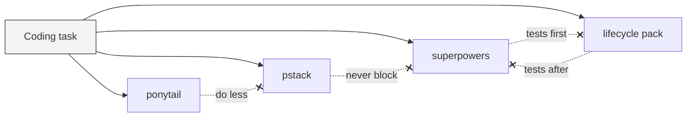
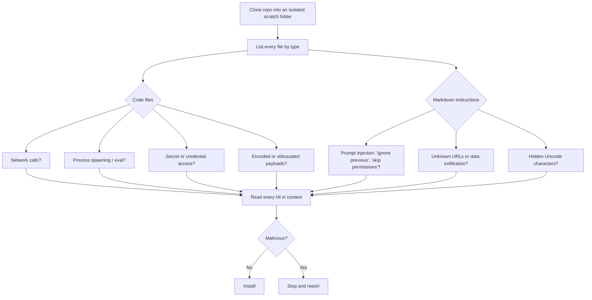
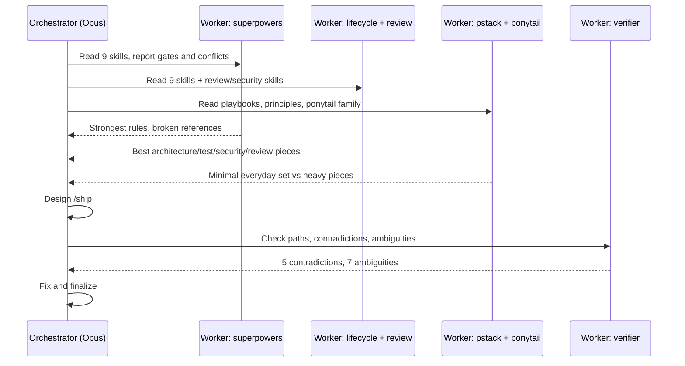
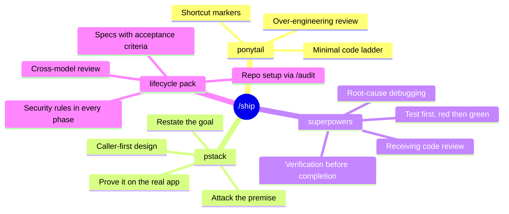
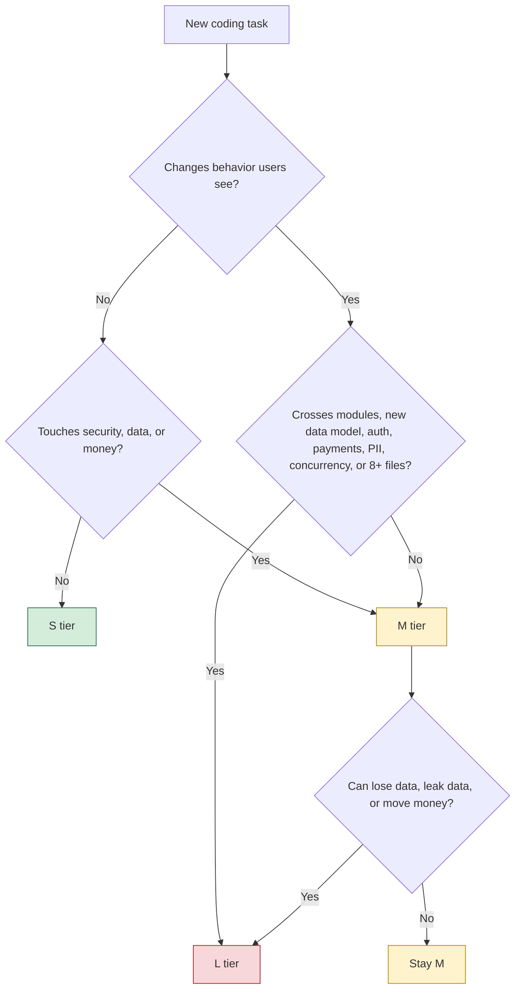
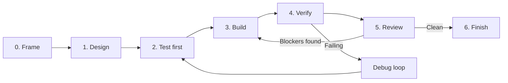
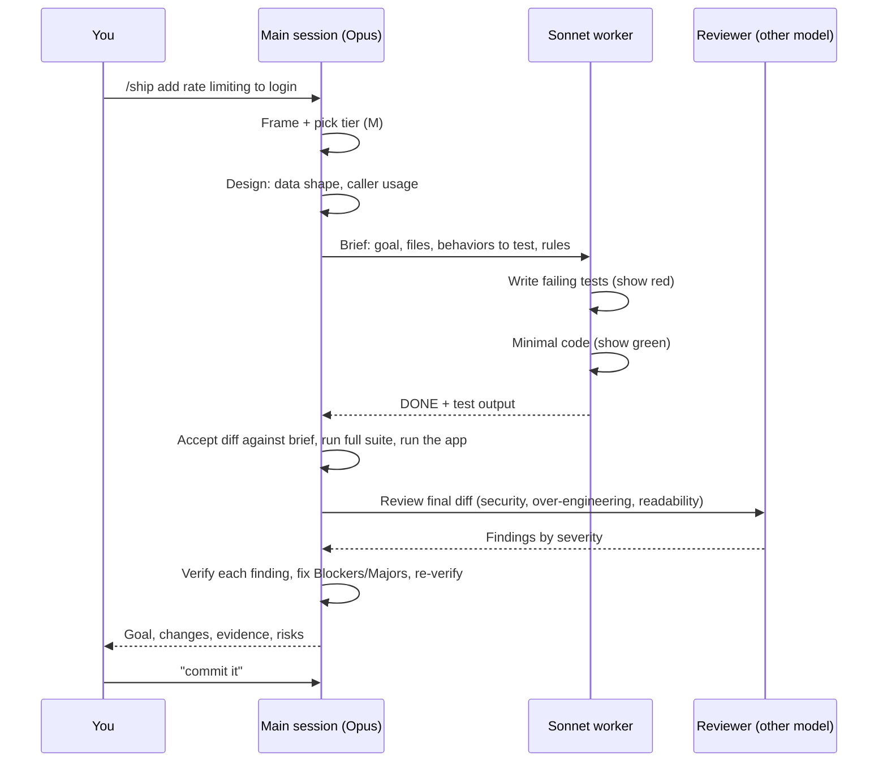
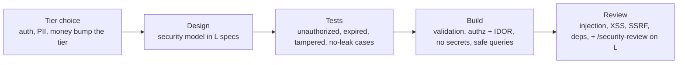

# One Command to Ship Better Code: Combining Four Claude Code Skill Packs into `/ship`

I had four Claude Code skill packs installed. Each one was good at something. Together they fought each other. This post covers how I audited them, merged the best parts into one command called `/ship`, and made it the default for every project.

## The problem

Claude Code skills are folders of instructions (`SKILL.md` files) that tell the agent how to work. I had collected four packs:

| Pack | What it is good at |
|---|---|
| **ponytail** | Writing the least code that works. Fighting over-engineering. |
| **pstack** (poteto-mode) | Engineering principles, design before code, proving changes on the real app. |
| **superpowers** | Test-first discipline, root-cause debugging, verification before claiming "done". |
| **lifecycle pack** (`/architect`, `/test`, `/check`, `/audit`) | Written specs, test writing, cross-model review, security checks spread across phases. |

The trouble: they overlapped and contradicted each other.

- Four different code reviewers. Three debugging loops. Two planning systems.
- ponytail says "do less". pstack says "build 2-3 prototypes and compare".
- superpowers' brainstorming says "you MUST use this before any change" and stops for approval. pstack says "never block on the human".
- Some skills pointed at files that were never installed.
- pstack was written for Cursor, so its default model names did not exist in Claude Code.

Running all of them on every task would be slow and expensive. Picking skills by hand each time would mean I would stop doing it.



*Before: four packs pulling in different directions on the same task.*

## Step 1: Security check before installing anything

Skills are instructions an AI agent follows, and some ship scripts it can run. A malicious skill could tell the agent to leak secrets or run harmful commands. So every new pack got checked before it was installed.



What the checks found:

- **pstack (569 files):** clean. Its scripts only call `gh`, `git`, a pinned npm package with a checksum, and a checksummed TLA+ jar from the official GitHub release. One behavior was overridden: its "external actions proceed without asking" rule. The agent still asks before sending, posting, pushing, or deploying.
- **superpowers (68 files installed):** clean. Its one network component, a brainstorming preview server, binds to `127.0.0.1` only and requires a random token plus an origin check. It opens a browser only when you opt in.

## Step 2: Audit every skill

Three research subagents read the packs in parallel and reported each skill's purpose, phase, gates, cost, and conflicts. The main session merged the findings.



Key findings:

- Several superpowers skills were an older version with missing support files. I reinstalled them from upstream and backed up the old copies.
- Almost every pstack skill can only be started by the user typing it, not by the agent. A default workflow has to read those files directly.
- Full pstack rigor on every task is too heavy. It belongs on big or unattended work.

## Step 3: Pick the best piece for each job

For every phase of development, the strongest version of each idea was kept and the duplicates were dropped.

| Phase | Kept from | The rule |
|---|---|---|
| Frame | pstack, ponytail | Restate the goal. Ask "does this need to exist?" Read callers before writing. |
| Design | pstack, lifecycle `/architect` | Write the caller's usage first, then the types. Big work gets a spec with numbered acceptance criteria. |
| Tests | superpowers, pstack `tdd`, lifecycle `/test` | Failing test first. Each test names the bug it catches. Mock only external things. Never weaken an assertion. |
| Build | ponytail, lifecycle `/develop` | Reuse, then stdlib, then native, then a dependency, then new code. Authorization on every action. No secrets in logs. |
| Debug | superpowers, lifecycle `/debug` | Reproduce, localize, one hypothesis at a time. Three failed fixes means question the design. |
| Verify | pstack, superpowers, lifecycle `/check` | Run it on the real app. No "done" without fresh command output. |
| Review | lifecycle `/check review`, ponytail-review, superpowers | Reviewer runs on a different model than the author. Separate passes for security, over-engineering, readability. |
| Finish | pstack, superpowers | Short evidence-based report. Commit and PR only when asked. |



## How `/ship` works

### Ceremony scales with risk

A typo fix should not get a spec and three reviewers. A payment change should. `/ship` sizes every task into a tier before doing anything.



Any bug fix is at least M, because it needs a test that reproduces the bug.

### The loop



### What each tier runs

| Phase | S | M | L |
|---|:---:|:---:|:---:|
| Frame: restate goal, read callers | ✅ | ✅ | ✅ |
| Design: data shape, caller-first | | ✅ | ✅ |
| Spec via `/architect` | | | ✅ |
| Failing test first | only if logic changes | ✅ | ✅ + tagged to spec |
| Built by Sonnet workers | one-liners inline | ✅ | ✅ in parallel |
| Full suite + run the real app | ✅ | ✅ | ✅ + `/check verify` |
| Mutation check | | | critical logic |
| Self-review against security list | ✅ | | |
| Security + over-engineering + readability reviewers | | ✅ | ✅ |
| Built-in `/security-review` + blast radius | | | ✅ |
| Report length | code + 3 lines | full report | full report + `/document` |

### Who does what

My standing rule is that Opus orchestrates and Sonnet workers build. `/ship` keeps that split and adds one rule from the lifecycle pack: code is reviewed by a different model than the one that wrote it.



### Security is built into every phase

There is no single "security step" to forget. It shows up in five places:



## How to use it

| Command | What it does |
|---|---|
| `/ship <task>` | Runs the full loop and picks the tier itself. |
| `/ship S\|M\|L <task>` | Forces a tier. |
| `/ship review` | Reviews the current diff only. |
| `/ship setup` | One-time repo prep: finds test/lint/run commands, records conventions in `AGENTS.md`, proposes a test framework and pre-commit checks (asks before installing). |
| `/poteto-mode` | Heavy mode for multi-hour, unattended, or multi-PR work. |
| "stop ship" | Turns it off for the session. |

You usually do not need to type `/ship` at all. A rule in the global `~/.claude/CLAUDE.md` makes it the default for any coding task in any project:

```markdown
# ship: default dev workflow (on by default)
- On ANY coding task in any project, read ~/.claude/skills/ship/SKILL.md
  once per session and follow it without being asked.
```

The same file sets precedence, so packs stop fighting:

- `/ship` decides which other skills run on coding tasks.
- Skills that stop for approval (brainstorming, plan writing) run only when named.
- Model choices follow the orchestration rule, not each pack's defaults.
- Outward actions (push, PR, deploy, messages) always need a yes.

### A first session in a new repo

```text
> /ship setup
  Detects stack, test and lint commands, writes AGENTS.md, offers a test framework.

> fix the bug where the cart total ignores discounts
  Tier M (bug fix). Repro test fails, root cause found, fix, suite green,
  reviewed on a second model, short report with evidence.

> add Stripe webhooks for refunds
  Tier L (money). Spec with acceptance criteria, security model, tests per AC,
  parallel workers, /security-review, blast-radius pass.
```

