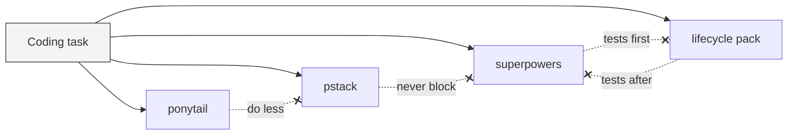

# One Command to Ship Better Code: Combining Four Claude Code Skill Packs into `/ship`

I had four Claude Code skill packs installed. Each one was good at something. Together they fought each other. This post covers how I audited them, merged the best parts into one command called `/ship`, and made it the default for every project.

## The problem

Claude Code skills are folders of instructions (`SKILL.md` files) that tell the agent how to work. I had collected four packs:

| Pack | What it is good at |
|---|---|
| **ponytail** | Writing the least code that works. Fighting over-engineering. |
| **pstack** (poteto-mode) | Engineering principles, design before code, proving changes on the real app. |
| **superpowers** | Test-first discipline, root-cause debugging, verification before claiming "done". |
| **lifecycle pack** (`/architect`, `/test`, `/check`, `/audit`) | Written specs, test writing, cross-model review, security checks spread across phases. |

The trouble: they overlapped and contradicted each other.

- Four different code reviewers. Three debugging loops. Two planning systems.
- ponytail says "do less". pstack says "build 2-3 prototypes and compare".
- superpowers' brainstorming says "you MUST use this before any change" and stops for approval. pstack says "never block on the human".
- Some skills pointed at files that were never installed.
- pstack was written for Cursor, so its default model names did not exist in Claude Code.

Running all of them on every task would be slow and expensive. Picking skills by hand each time would mean I would stop doing it.

*Before: four packs pulling in different directions on the same task.*

